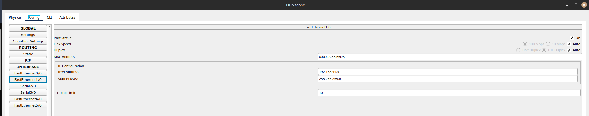
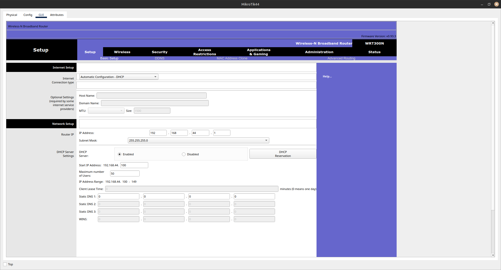
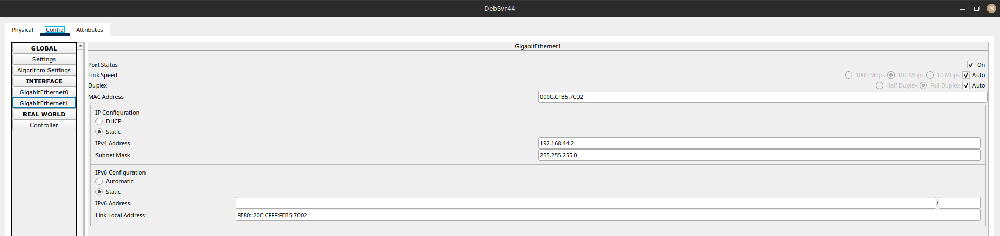
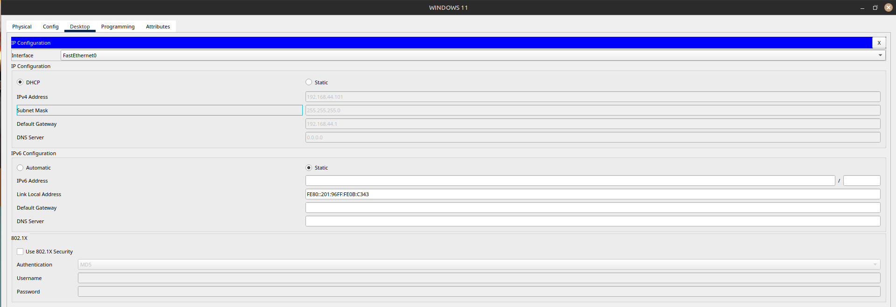
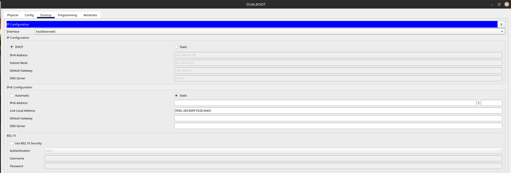
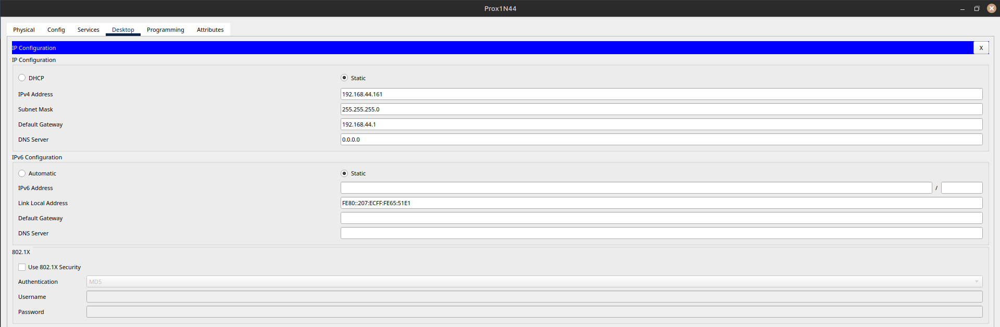
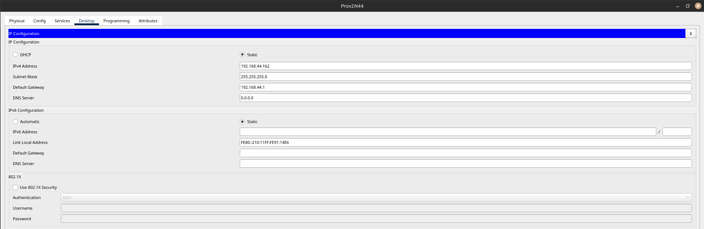
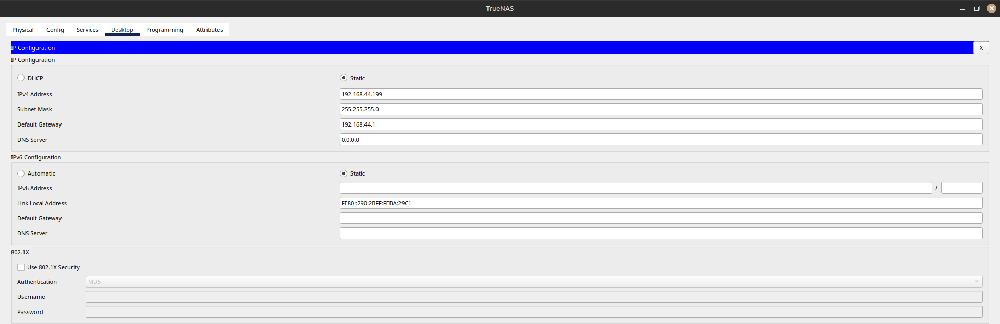
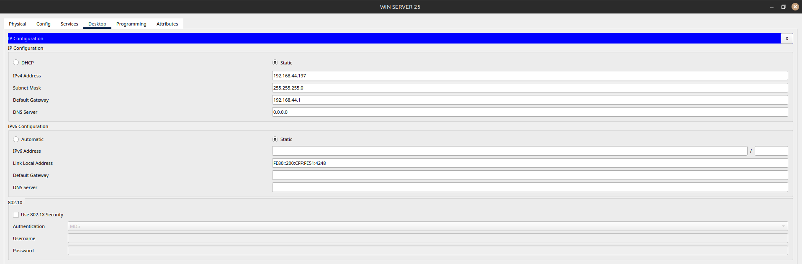

# Documentación T4 - Implementación de Red (Ap+)

## Introducción
Este documento detalla la implementación física y lógica del entorno de red individual para el proyecto ASIX ThinkLab, siguiendo el diseño en VirtualBox y utilizando la subred `192.168.44.0/24`.

## Esquema de Direccionamiento IP
Se ha establecido el siguiente rango de IPs para organizar los distintos roles del sistema:

| Rango de IP | Rol |
| :--- | :--- |
| `192.168.44.1 - 10` | Enrutadores y dispositivos de comunicación |
| `192.168.44.100 - 150` | Clientes |
| `192.168.44.160 - 170` | Nodos Proxmox |
| `192.168.44.180 - 200` | Servidores |

---

## Análisis de Máquinas

### Comunicaciones (Enrutadores)

| Máquina | Rol | Imagen |
| :--- | :--- | :--- |
| **OPNsense** | Firewall perimetral y gestión de seguridad. |  |
| **MikroTik** | Router principal de la red para gestión de rutas. |  |
| **DebianSvr** | Servidor de infraestructura y enrutamiento secundario. |  |

### Clientes

| Máquina | Rol | Imagen |
| :--- | :--- | :--- |
| **Windows 11** | Cliente para pruebas de entorno de usuario. |  |
| **Dual Boot** | Cliente para pruebas de interoperabilidad. |  |

### Proxmox (Nodos)

| Máquina | Rol | Imagen |
| :--- | :--- | :--- |
| **Proxmox 1** | Nodo principal de hipervisoría. |  |
| **Proxmox 2** | Nodo secundario para redundancia. |  |
| **Proxmox 3** | Nodo terciario para estabilidad del clúster. |  |

### Servidores

| Máquina | Rol | Imagen |
| :--- | :--- | :--- |
| **TrueNAS** | Almacenamiento centralizado (NAS). |  |
| **Win Server** | Active Directory. |  |
