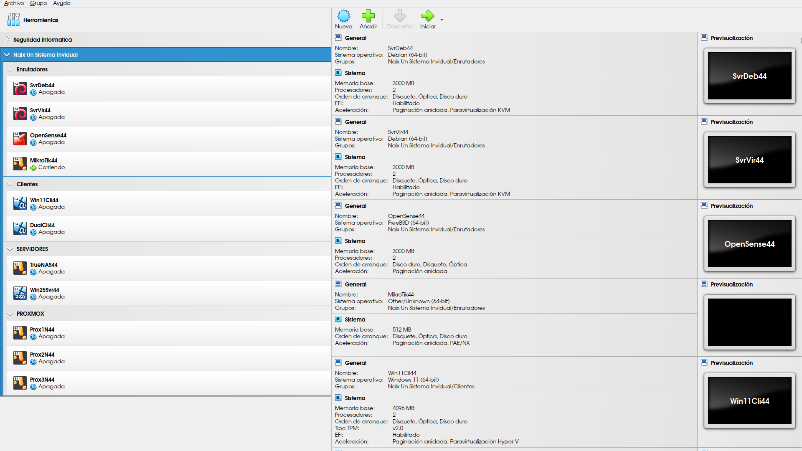

# Instalación de Servidores y Máquinas (Tasca 5 - Ap)

## Introducción
Este documento detalla el proceso de instalación y despliegue de los sistemas operativos y servidores definidos en el proyecto ASIX ThinkLab, siguiendo las especificaciones del entorno individual de pruebas.

## Procedimiento de Instalación
Se han instalado los sistemas operativos correspondientes en sus respectivas máquinas virtuales de VirtualBox, asegurando la configuración de red y recursos necesarios para su correcto funcionamiento dentro de la subred `192.168.44.0/24`.

### Entorno de Virtualización
La base de despliegue ha sido VirtualBox, utilizando las configuraciones base establecidas en la Tasca 0.

## Lista de Sistemas Instalados

| Sistema Operativo | Rol | Justificación |
| :--- | :--- | :--- |
| **Proxmox VE** | Nodos del Clúster | Hipervisor base para alta disponibilidad. |
| **TrueNAS** | Almacenamiento (NAS) | Gestión centralizada de datos. |
| **OPNsense** | Firewall / Router | Seguridad perimetral y enrutamiento. |
| **Debian Server** | Infraestructura | Servicios críticos de red. |
| **Windows Server** | Infraestructura | Servicios de dominio y gestión (si aplica). |
| **Windows 11** | Cliente | Entorno de usuario de pruebas. |

## Conclusión
La instalación se ha completado con éxito, verificando que cada sistema arranca correctamente, tiene asignada su IP correspondiente dentro del rango establecido y dispone de los recursos hardware mínimos requeridos para su rol.
